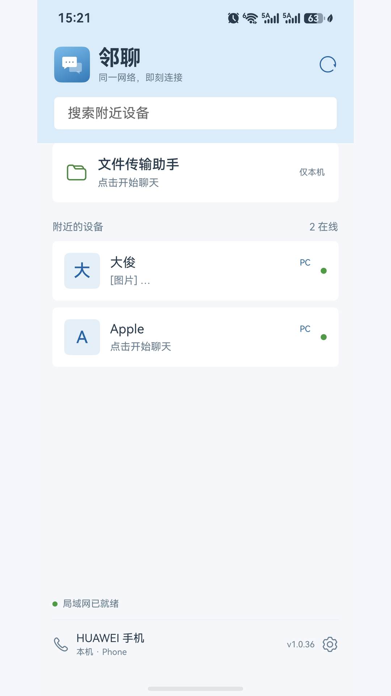
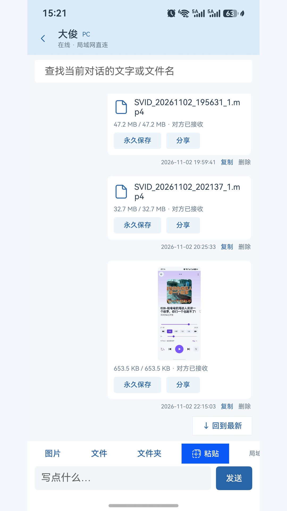
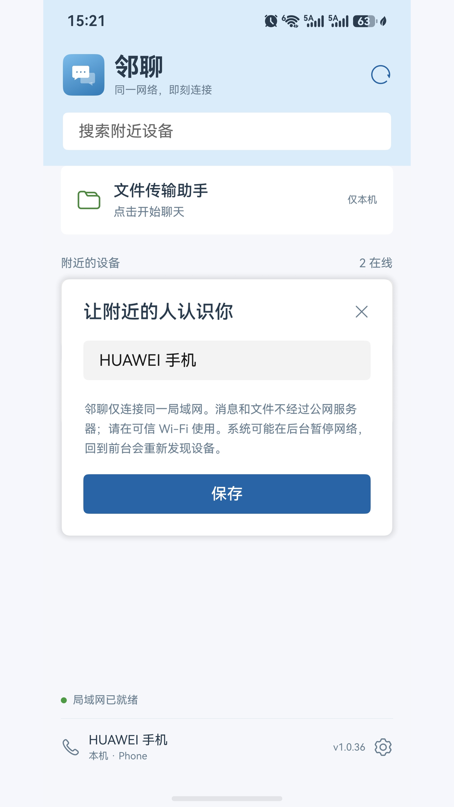

# LocalChat for HarmonyOS


LocalChat (邻聊) is a native HarmonyOS app for messaging and file sharing across devices on your local network. Built with ArkTS and ArkUI, it communicates directly with the macOS LocalChat client without accounts or a cloud relay.

**Current version:** 1.0.52 · **Minimum SDK:** HarmonyOS 6.1.1 (API 24) · **Bundle ID:** `com.hohode.localchat`

## Screenshots

Captured on a HarmonyOS phone with the Chinese interface in v1.0.36. The current interface may differ slightly.

| Nearby devices | Chat and file sharing | Device settings |
| --- | --- | --- |
|  |  |  |

## Features

- **Automatic device discovery:** Find nearby clients using mDNS, connect over TCP, and recover connections when returning to the foreground.
- **Local messaging:** Send Unicode and multiline text with delivery acknowledgments, duplicate detection, searchable history, and per-conversation reading positions.
- **Images and attachments:** Select photos, files, or folders; preview images; manage multiple attachments; and send attachments without accompanying text. A system paste button supports text and images.
- **File and folder transfers:** Transfer files in 48 KB chunks with progress and completion acknowledgments. Folder transfers preserve nested folders, empty directories, empty files, and Unicode names without creating an archive.
- **Offline queue:** Keep outgoing messages and attachment copies locally, then retry when both devices are online and reachable. Pending messages survive app restarts.
- **File Transfer Assistant:** Keep text, images, files, and folders locally without another device.
- **System sharing:** Receive text, links, images, and files from other apps, then tap a device to queue delivery or the assistant to save locally. Incoming shares support up to nine items.
- **Save received content:** Export files and folders through system pickers. Received images can be saved to the gallery through the system authorization dialog, with the original retained in chat.
- **Notifications:** Local message notifications, unread counts, and app badges, subject to system permissions and settings.

## Getting started

1. Run LocalChat on your HarmonyOS device and a compatible client on another device.
2. Connect both devices to the same local network and allow local network traffic through any firewall.
3. Open a discovered device to send messages or attachments.

Offline delivery requires both devices to run LocalChat at the same time once connectivity returns. Folder transfers require compatible versions on both ends; older clients can still exchange ordinary files.

## Build from source

The supplied scripts target macOS with DevEco Studio installed at `/Applications/DevEco-Studio.app`. Install the HarmonyOS 6.1.1 (API 24) SDK and, for the interoperability tests, the Swift compiler.

```sh
git clone git@github.com:wangjunbo/LocalChat.git
cd LocalChat
cp build-profile.example.json5 build-profile.json5
```

Open the project in DevEco Studio, let it resolve project dependencies, and configure your own local debug signing profile. Local signing configuration and certificate files are excluded from Git. Keep the existing bundle ID unless you are intentionally creating a separate app.

Build and validate the package:

```sh
./scripts/build.sh
```

The script assembles the HAP, checks the packaged version, permissions, and icon references, and copies the output to `distribution/`:

```text
entry/build/default/outputs/default/entry-default-unsigned.hap
distribution/邻聊-HarmonyOS-v1.0.52-unsigned.hap
distribution/邻聊-HarmonyOS-v1.0.52-signed.hap  # when signing is configured
```

A debug-signed HAP is limited to the devices allowed by its signing profile. Building does not install the app.

## Testing

Run the core and macOS interoperability suite with DevEco Studio's bundled Node.js:

```sh
/Applications/DevEco-Studio.app/Contents/tools/node/bin/node scripts/test-core.cjs
```

The interoperability test needs the macOS LocalChat source tree. Its default location is `/Users/sunshine/SwiftProjects/local-chat`; override it when necessary:

```sh
LANCHAT_MAC_SOURCE=/path/to/local-chat \
  /Applications/DevEco-Studio.app/Contents/tools/node/bin/node scripts/test-core.cjs
```

The suite covers protocol framing, message delivery, device identity, history, offline queues, file and folder transfers, gallery saving, incoming shares, reading positions, network recovery, and background lifecycle handling. It also compiles the original Swift `ChatStore` and tests real TCP communication with the ArkTS store running through Node platform adapters, including bidirectional text, files, folders, and receipt confirmation.

Interoperability tests use an isolated `_lcharmonytest._tcp` service and temporary data rather than normal client sessions.

**Validation scope:** The current build, package checks, Node adapter tests, and Swift TCP interoperability tests pass. These checks do not establish native HarmonyOS mDNS, gallery authorization, paste, notification, picker, or ArkUI behavior on a physical device. See the [device test notes](docs/DEVICE-TEST.md) for additional context.

## Network and storage behavior

LocalChat discovers devices using `_lanternchat._tcp`. Messages use length-prefixed UTF-8 JSON frames over TCP; file chunks are Base64-encoded inside those frames. See the [wire protocol](docs/PROTOCOL.md) and [folder transfer protocol](docs/folder-protocol.md) for details; these documents are currently in Chinese.

There is no account service, cloud storage, or internet relay. The protocol currently provides neither peer authentication nor transport encryption, so use LocalChat on a trusted local network. Device names and types are self-reported.

Attachments and received files are stored in the app's private storage unless exported. Export anything you need to keep before uninstalling the app or clearing its data. File size is constrained by available storage and the filesystem; the app does not impose a total file size limit. Interrupted transfers restart rather than resume from a byte offset. Folder transfers preserve content and structure, but do not synchronize platform-specific permissions or extended attributes.

HarmonyOS controls background execution. When networking is ready, the app requests a short suspension delay on entering the background, uses the duration granted by the system, and does not renew it repeatedly. Background reception is therefore limited and cannot replace cloud push notifications. Discovery and connections are recovered when the app returns to the foreground.

System share contact recommendations additionally depend on Huawei Intents Kit enrollment and system availability. Ordinary sharing remains available if recommendations are unavailable.

## Project layout

```text
AppScope/                    Application metadata and shared icons
entry/src/main/ets/
  background/                Short background receive window
  entryability/              Application lifecycle and share entry
  model/                     Models and app version
  network/                   mDNS discovery, TCP connections, wire protocol
  notifications/             Local notifications and unread badges
  pages/                     ArkUI interface
  store/                     Chat state, persistence, identity, folder transfers
scripts/                     Build, package validation, and interoperability tests
docs/                        Protocol documentation and device test notes
distribution/                Icon assets and generated HAP packages
```

## License

[MIT](LICENSE)
